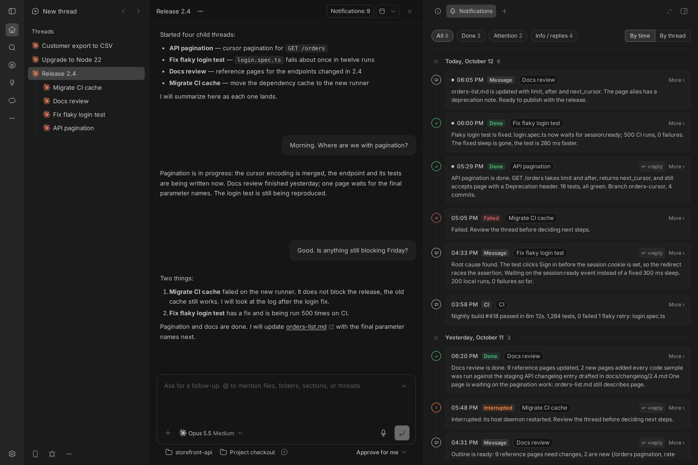

# Notify Feed



A BB plugin that moves child-thread traffic and background notices out of a thread's main conversation into a dedicated Notifications tab.

When a root thread assigns work to child threads, its chat fills with handoff messages, progress updates, and completion reports. Your conversation with the main agent gets lost under these rows. Notify Feed hides those entries from the main timeline and displays them in a side panel. Message delivery remains unchanged: agents still receive all messages.

## What it does

The plugin removes these entries from the main timeline:

- Messages sent by other threads.
- BB system notices for child threads (completed, failed, interrupted, needs attention, and batch digests).
- Messages from external tools whose first line is `[notify:Name]`.
- Finished agent replies that start with the configured reply marker.

User messages, standard agent replies, and turns in progress stay in the main timeline.

A button in the thread header shows the total notification count, or the number of unseen entries. Clicking the button opens the Notifications tab:

- Entries are grouped by day, newest first, with filters for All, Done, Attention, and Info / replies. Click a card to read its full text.
- A thread message and its completion notice within 60 seconds merge into one card.
- Thread IDs and task keys in messages turn into clickable links.
- Switch between timeline order and by-thread view to browse sending threads by state, then read the whole conversation in time order.
- Send a reply directly to a child thread from the tab. Enter sends the message, and Shift+Enter inserts a newline.
- Turn on Tell the agent to send a short note to the host agent that you wrote to the child thread.

The tab layout has no width thresholds and was tested at panel widths from 280 to 900 px and in a 390×844 phone window.

## Installation

Install using the BB CLI:

```sh
bb plugin install git:https://github.com/Sargares22/bb-plugin-notify-feed.git@^0.3.0
```

Requires BB 0.45 or later. The plugin runs entirely on the local machine and makes no external network requests.

## Settings

Configure the plugin in Settings -> Plugins -> Notify Feed, or with `bb plugin config notify-feed set <key> <value>`.

| Key | Default | Description |
| --- | --- | --- |
| `language` | `en` | Interface language: `en` or `ru`. In Russian, system notices in the tab are translated. |
| `marker` | `""` | Reply prefix, such as `[bg]`. When set, agents receive an instruction to prefix short background replies with this marker, moving them to the tab. When empty, no instruction is added. |
| `hide` | `true` | Hides notification rows in the main feed. When set to `false`, the main feed returns to default while the tab remains active. |
| `threads` | `[]` | JSON array of thread IDs where the plugin runs. An empty array enables the plugin across all threads. |

Settings changes apply on the next poll cycle, within 8 seconds.

## Messages from outside tools

External scripts and services that post to a thread appear as standard user messages. To move an external message into the Notifications tab, format its first line as `[notify:Name]`, followed by the message body on subsequent lines.

The name must contain 1 to 32 characters (letters, numbers, spaces, hyphens, or dots) and start with a letter or number. The card displays this name as a badge and hides the header line. Any formatting deviation leaves the message in the main feed.

## How to turn off

- Restore feed rows while keeping the tab: `bb plugin config notify-feed set hide false`
- Disable the plugin completely: `bb plugin disable notify-feed`

Disabling the plugin restores feed rows immediately without requiring a window reload.

## Limitations

- Hiding timeline rows and rendering the header button depend on BB experimental slots (`experimental_appOverlay` and `experimental_threadHeaderAction`), as well as internal timeline DOM attributes (`data-timeline-row-id`). Future BB updates may alter these interfaces. If experimental slots are unavailable, the plugin falls back to registering the tab in the right panel menu.
- The timeline is polled every 8 seconds. New rows are hidden after a delay of up to 8 seconds.
- If two consecutive polls fail, hiding is disabled until the next successful poll to avoid hiding content based on stale data.
- In virtualized feeds, hidden rows leave a 1px element in the DOM.
- The reply field in the tab enforces a limit of 20,000 characters.
- Notes sent to the host agent trigger a new turn for that agent, as BB requires a turn to deliver messages.
- At most 20 pages of timeline history are read per thread.
- Thread archive status is cached and refreshed every 10 minutes.
- The plugin stores up to 300 sent messages per thread in local KV storage.

## Development

```sh
npm ci
npm run typecheck
bb plugin build
bb plugin install .
```

All UI strings are defined in `i18n.ts`.

## License

MIT
